# Assignment 2: Image Processing

Eivind Systad Geiran and Trym Andreas Johnsen - IT3212

Code: [Image Processing Scene Analysis](https://github.com/TrymJohnsen/Image-Processing-Scene-Analysis)

## The dataset

We use the Intel Image Classification dataset supplied through Blackboard. Its six outdoor scene categories include buildings, forests, glaciers, mountains, sea and streets. Different image types are selected to expose differences in frequency content, texture and shape.

Fourier experiments use `buildings/1001.jpg` at 150 × 150 pixels. PCA uses 200 randomly selected building images, with seed 42. HOG uses `sea/10399.jpg`, `buildings/1001.jpg`, `street/10019.jpg` and `forest/10037.jpg`, resized to 128 × 128. Blob and contour detection share four original 150 × 150 images: `sea/10399.jpg` (boat), `buildings/10310.jpg` (windows), `street/10015.jpg` (lamps) and `sea/1021.jpg` (rocks).

For LBP, we load `brick` and `astronaut` through scikit-image, alongside the Intel forest image. The library documents CC0Textures as the brick image's original source and NASA as the source of the Eileen Collins photograph [4]. We crop the face using rows 10:210 and columns 130:330. Processing uses grayscale; detection overlays retain colour. PCA and HOG intensities are scaled to [0, 1]; Fourier errors use [0, 255].

## 1. Fourier Transform

### 1.1 Frequency spectrum

The spatial image stores intensities at pixel locations. Its two-dimensional discrete Fourier transform (DFT) represents spatial frequency components [1]. We compute it with NumPy's `fft2`; `fftshift` moves zero frequency to the centre [2]. Plotting `log(1 + |F|)` makes weaker magnitudes visible.

Figure 1 concentrates energy near the centre, corresponding to gradual intensity changes and large structures. Its horizontal and vertical frequency patterns are consistent with repeated floors, windows and columns. The magnitude spectrum describes frequency strength and direction, but does not directly locate individual objects.

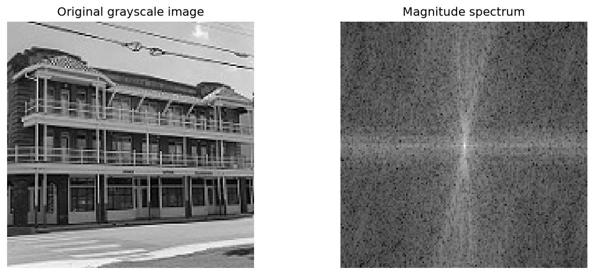

*Figure 1. Original building image and centred logarithmic DFT magnitude.*

### 1.2 Low-pass filtering

We add Gaussian noise with mean 0, standard deviation 25 and seed 42, clipping intensities to [0, 255]. Circular masks retain frequencies within radii 10, 20, 35, 50 and 70. Removing higher frequencies reduces noise, but also removes genuine edges. Figure 2 and Table 1 compare inverse-transform reconstructions with the clean original. MSE averages squared pixel differences after clipping filtered images.

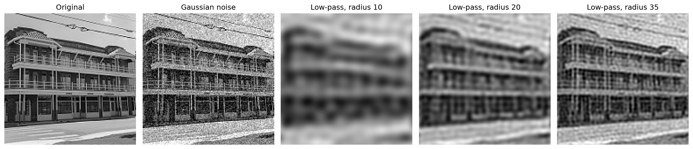

*Figure 2. Clean image, fixed noisy image and five low-pass reconstructions.*

*Table 1. Low-pass MSE against the clean original.*

| Image/filter | MSE | Change from noisy MSE |
|---|---:|---:|
| Noisy, unfiltered | 596.65 | 0.00 |
| Radius 10 | 1412.22 | +815.57 |
| Radius 20 | 954.71 | +358.06 |
| Radius 35 | 724.83 | +128.18 |
| Radius 50 | 563.39 | −33.26 |
| Radius 70 | 492.88 | −103.77 |

Radius 10 heavily blurs windows and railings. Radii 20 and 35 restore progressively more structure. All three look smoother than the noisy image while increasing MSE: the lost building detail outweighs the noise reduction. Radii 50 and 70 preserve finer edges and improve MSE, although noise remains visible. Radius 70 is best among the tested values. The useful cutoff depends on the image, noise level and desired balance between smoothing and detail preservation. MSE measures pixel error rather than perceptual quality, so we inspect both the figure and the numerical changes.

### 1.3 High-pass filtering

Complementary circular masks with radii 10, 20 and 35 suppress low frequencies in the clean image. Figure 3 displays absolute inverse-transform responses on a shared scale. Smooth regions and overall brightness disappear because they depend mainly on low frequencies.

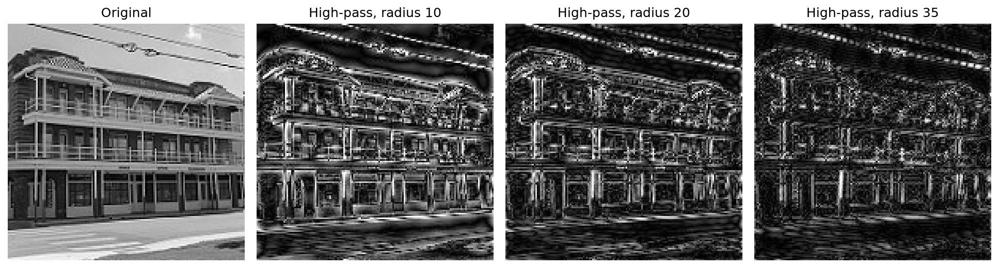

*Figure 3. Absolute high-pass responses for three cutoff radii.*

Radius 10 retains broad outlines and texture. At 20, windows, columns and overhead wires stand out; at 35, fine transitions dominate and wider structures weaken. These are edge-like responses, rather than normally sharpened photographs. High-pass filtering would also retain high-frequency noise. The abrupt cutoff can cause ringing near strong edges.

### 1.4 Fourier compression

We rank conjugate groups by mean coefficient magnitude and retain the strongest groups. Both members of each conjugate pair are kept, preserving the symmetry required for a real reconstruction [2]. Self-conjugate coefficients count once. Completing a pair can exceed the requested count by one, so Table 2 reports actual percentages. Symmetry and imaginary residuals are checked before using the real part; the largest residual is 7.21 × 10⁻¹⁴ intensity units.

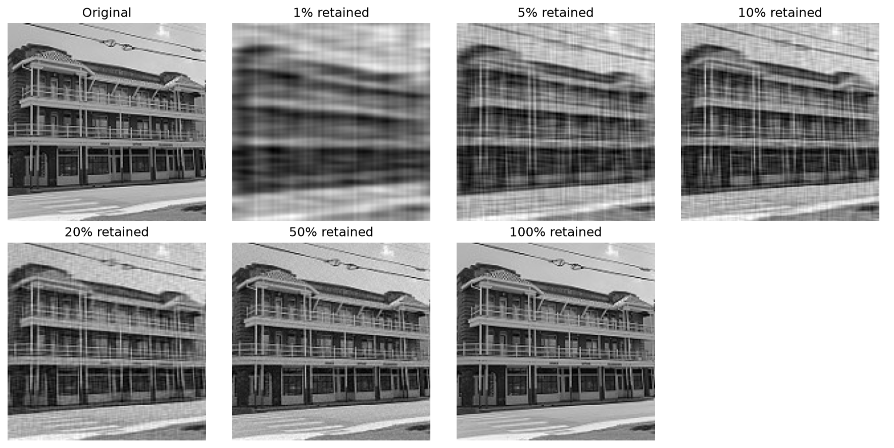

*Figure 4. Reconstructions using increasing proportions of Fourier coefficients.*

*Table 2. Fourier reconstruction error and total-to-retained coefficient ratio.*

| Requested | Actual retained | MSE | Coefficient ratio |
|---:|---:|---:|---:|
| 1% | 1.0000% | 1118.34 | 100.00:1 |
| 5% | 5.0044% | 613.75 | 19.98:1 |
| 10% | 10.0000% | 395.36 | 10.00:1 |
| 20% | 20.0044% | 206.67 | 5.00:1 |
| 50% | 50.0044% | 46.48 | 2.00:1 |
| 100% | 100.0000% | 0.00 | 1.00:1 |

Figure 4 remains recognisable at 1%, but strong blur and line patterns replace fine details. At 5–10%, floors and windows become clearer. Approximately 20% preserves major structure with fivefold coefficient reduction; 50% recovers much more edge detail. MSE decreases throughout, reaching numerical round-off at full retention. Compression MSE uses unclipped reconstructions; only the displayed images are clipped. These ratios count coefficients, not compressed file bytes: values, positions, precision and encoding overhead also require storage.

## 2. Principal Component Analysis

We use buildings because façades, windows and sky provide recurring structure while viewpoint and lighting still vary. Mixing unrelated categories would instead introduce variation between scene types. Each image is converted to grayscale, resized to 64 × 64 and divided by 255. Flattening produces a 200 × 4096 matrix, with images as rows and pixels as columns. Our NumPy implementation subtracts the pixel-wise mean to obtain centred data, Xc.

Pixel covariance is C = XcᵀXc / (n − 1), with n = 200. Instead, we diagonalize G = XcXcᵀ / (n − 1), a 200 × 200 matrix rather than 4096 × 4096. The matrices share their nonzero eigenvalues, allowing the smaller eigensystem to recover the same PCA directions. Its eigenvectors are mapped into pixel space and normalized, yielding the principal directions of C. Eigenvalues and corresponding directions are sorted in descending order. Projection onto the first k directions gives k coefficients per image; reconstruction multiplies by those directions and restores the mean [1]. The functions `fit_pca`, `project` and `reconstruct` implement this pipeline.

Figure 5 compares three training images reconstructed with increasing k. Display values are clipped to [0, 1].

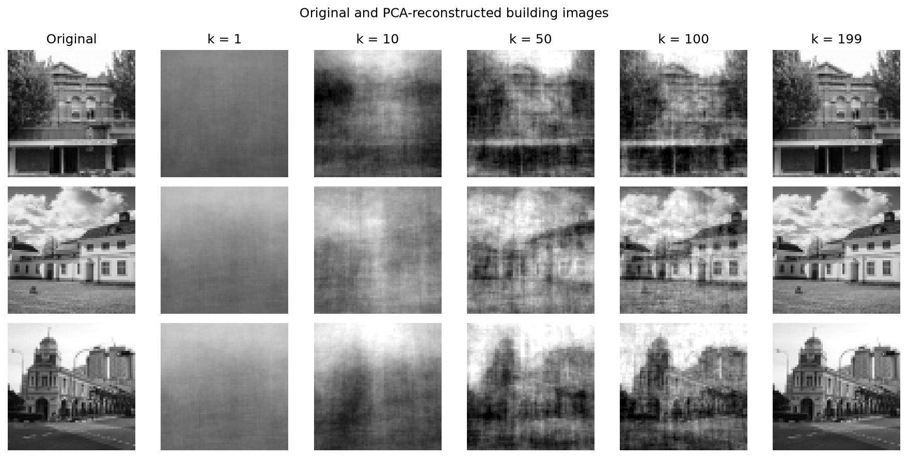

*Figure 5. Three training images reconstructed with increasing numbers of components.*

Figure 6 plots cumulative explained variance and marks the first component count reaching 90%.

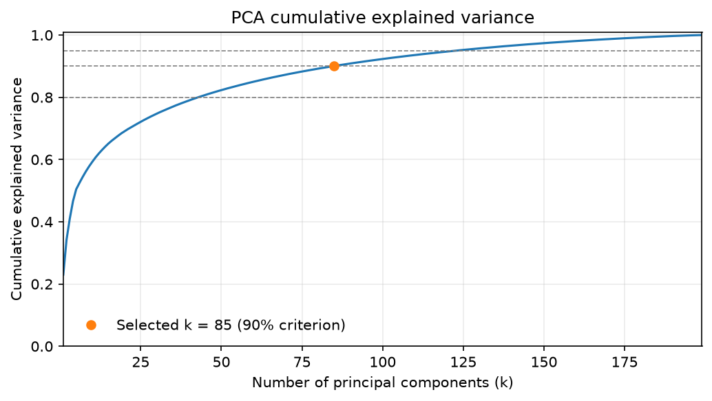

*Figure 6. Cumulative explained variance, with the selected 90% criterion marked.*

Table 3 reports MSE over all 200 images using unclipped reconstructions.

*Table 3. PCA variance, reconstruction error and per-image dimensionality reduction.*

| k | Explained variance (%) | MSE | 4096/k |
|---:|---:|---:|---:|
| 1 | 23.0208 | 0.04540999 | 4096.00:1 |
| 5 | 50.4459 | 0.02923193 | 819.20:1 |
| 10 | 59.2781 | 0.02402183 | 409.60:1 |
| 25 | 72.1147 | 0.01644952 | 163.84:1 |
| 50 | 82.3081 | 0.01043643 | 81.92:1 |
| 85 | 90.0621 | 0.00586236 | 48.19:1 |
| 100 | 92.3104 | 0.00453607 | 40.96:1 |
| 150 | 97.3965 | 0.00153580 | 27.31:1 |
| 199 | 100.0000 | 0.00000000 | 20.58:1 |

At k = 1, only broad intensity structure survives. At 10, coarse building layouts return; at 50, buildings are recognisable but blurred. Increasing to 85 and 100 restores more structure while still losing fine texture. Gains diminish as later components capture less variance.

The computed minimum reaching 90% variance is k = 85, a selected compromise using a 90% explained-variance criterion. It retains 90.0621%, with MSE 0.00586236 and approximately 48.19:1 dimensionality reduction per image. This criterion makes the choice explicit without claiming universal optimality.

Fitting and evaluation use the same 200 images. Near-zero MSE with all 199 meaningful components therefore shows training-set reconstruction, not generalization. Resizing removes fine detail, and unaligned buildings mean PCA also models viewpoint and sky placement. The 4096/k ratio excludes the shared PCA basis and mean image, which must also be stored. It is not complete storage compression. PCA MSE uses normalized intensities, so its numerical values cannot be compared directly with Fourier MSE.

## 3. HOG Features

HOG describes local shape through gradient-weighted orientation histograms within cells. Normalization over overlapping blocks reduces sensitivity to local contrast; concatenating these histograms produces the descriptor [1]. Our script uses scikit-image HOG with L2-Hys block normalization [3]. The displayed Sobel magnitude is a separate visualization; HOG computes its own gradients internally.

Figure 7 compares four scenes using nine orientation bins, 8 × 8-pixel cells and 2 × 2-cell blocks. The sea has relatively sparse strong structure around the horizon and boat, although weak water texture still contributes. The building has repeated horizontal and vertical patterns. The street combines vertical façades with perspective diagonals. The forest has dense, irregular responses from branches, trunks and ground texture.

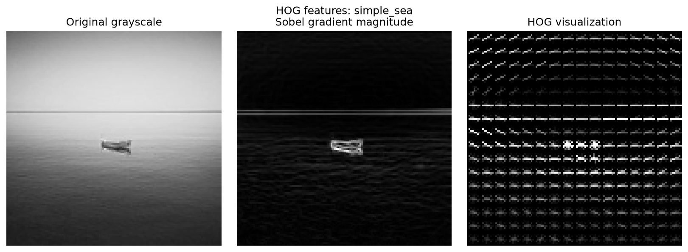

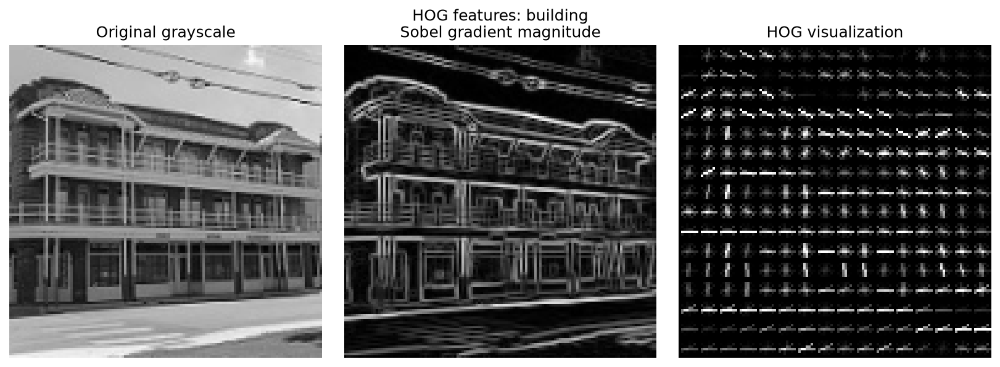

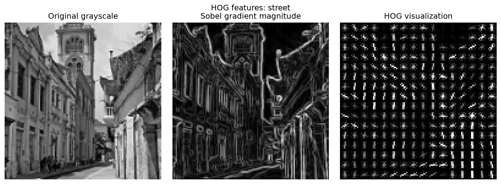

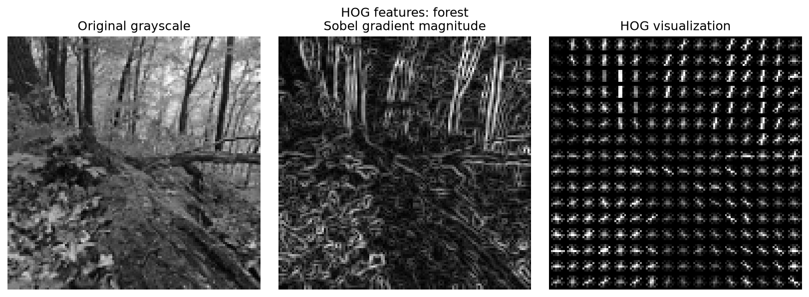

*Figure 7. Sea, building, street and forest, from top to bottom. Each row shows grayscale input, Sobel magnitude and HOG visualization.*

Summing normalized descriptor values gives relative HOG strength, not percentages of physical edges. The sea and building place 29.9% and 23.5% respectively in the 90° gradient bin. The street places 36.4% in the bins nearest 0° and 180°; forest shares range from 10.1% to 13.2%. Gradient directions are perpendicular to image edges.

Figure 8 and Table 4 vary one baseline parameter at a time on the building.

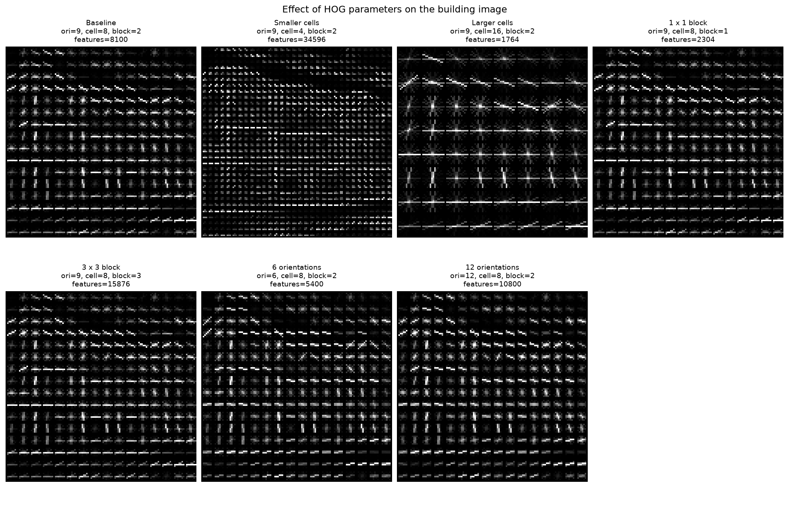

*Figure 8. Cell size, block size and orientation-bin experiments on the building.*

*Table 4. HOG descriptor lengths for 128 × 128 inputs.*

| Configuration | Bins | Cell pixels | Block cells | Values |
|---|---:|---|---|---:|
| Baseline | 9 | 8 × 8 | 2 × 2 | 8100 |
| Smaller cells | 9 | 4 × 4 | 2 × 2 | 34596 |
| Larger cells | 9 | 16 × 16 | 2 × 2 | 1764 |
| Smaller blocks | 9 | 8 × 8 | 1 × 1 | 2304 |
| Larger blocks | 9 | 8 × 8 | 3 × 3 | 15876 |
| Fewer bins | 6 | 8 × 8 | 2 × 2 | 5400 |
| More bins | 12 | 8 × 8 | 2 × 2 | 10800 |

Smaller cells retain finer spatial detail; larger cells merge local patterns. More bins refine directional resolution. Larger blocks change normalization context and descriptor length, but not the displayed cell-histogram pattern, which precedes block normalization [3]. Overlapping blocks repeat cell information, so descriptor growth does not imply proportionally more information. More spatial or directional detail generally costs a larger descriptor and more computation. The baseline keeps recognisable building structure without the longest descriptor. No classifier is trained, so these comparisons assess representation rather than predictive accuracy.

## 4. Local Binary Patterns

Our NumPy function `compute_lbp` compares each centre pixel with its eight direct neighbours. A neighbour at least as bright sets a 1; otherwise it sets a 0 [1]. Bits run clockwise from the top-left neighbour, assigned the lowest bit, producing codes 0–255. The separate function `lbp_histogram` counts these codes. Input images are 128 × 128; skipping borders produces 126 × 126 LBP images and 15,876 codes each.

Figure 9 displays the natural scene, regular texture and face, with their LBP outputs and histograms. The histograms describe the frequency of local texture patterns, but discard their positions [1]. Uniform codes have at most two circular bit transitions [5]. Only 58 of the 256 codes are uniform, so a share far above 23% means that simple structures such as flat areas, edges and corners dominate. Table 5 includes their share and histogram entropy, which measures how broadly codes are distributed.

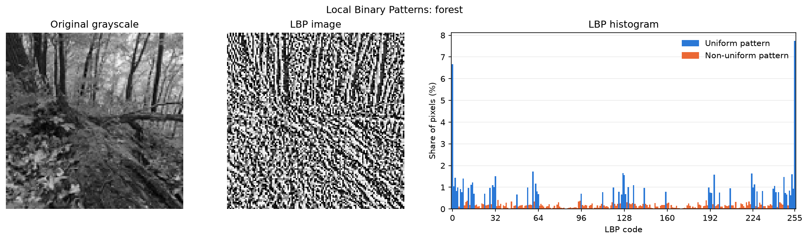

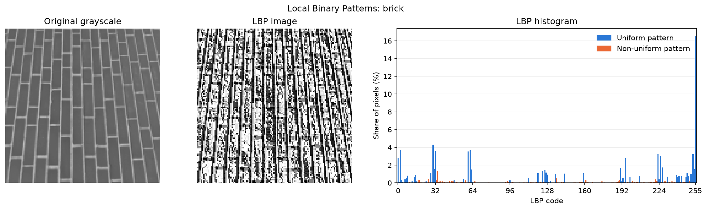

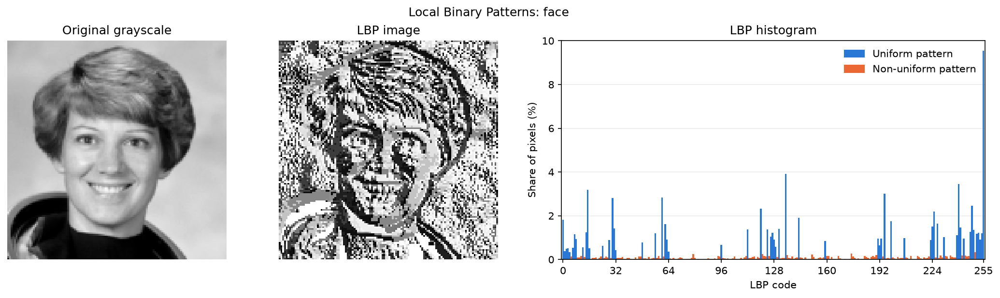

*Figure 9. Forest, brick and face, from top to bottom: input, LBP image and normalized histogram.*

*Table 5. LBP texture summaries.*

| Image | Uniform patterns (%) | Entropy (bits) | Three most frequent codes |
|---|---:|---:|---|
| Forest | 70.49 | 6.9247 | 255 (7.74%), 0 (6.68%), 60 (1.72%) |
| Brick | 86.00 | 5.7860 | 255 (16.57%), 30 (4.32%), 2 (3.71%) |
| Face | 84.71 | 6.3520 | 255 (9.54%), 135 (3.92%), 240 (3.45%) |

Brick has the most concentrated histogram, consistent with repeated straight joints and smooth surfaces after resizing. Its second most frequent code, 30 (`00011110`), has four adjacent neighbours set, which is the pattern of a straight edge. Forest uses all 256 codes and has the highest entropy, reflecting varied neighbourhoods. Code 0, where the centre is brighter than every neighbour, is nearly as frequent there as 255 and reflects small bright specks of light between leaves; no other code reaches 2%, so no edge direction dominates. The face lies between them: smooth shading mixes with curved facial boundaries. Its edge codes 135 (`10000111`) and 240 (`11110000`) also have four adjacent neighbours set, but on different sides of the centre. Code 255 dominates all three and means no neighbour is darker than the centre, occurring in flat regions and local minima.

LBP ignores contrast magnitude, so weak noise can change codes as readily as strong texture. Its comparison-based encoding is invariant to monotonic grayscale transformations that preserve neighbour comparisons [5], but clipping and quantization can change patterns. Resizing changes the texture scale, and our basic codes depend on rotation. The brick surface becomes smoother when reduced from 512 × 512, so its concentrated histogram partly reflects preprocessing rather than texture alone.

## 5. Blob Detection

Blob detection locates image regions that differ in intensity from their surroundings [1]. Scale selection compares normalized derivative responses across scales to identify structures at characteristic sizes [7]. Our detector constructs the scale-normalized Laplacian of Gaussian response, σ²∇²(Gσ * I), for 11 scales from σ = 2 to 12. Multiplication by σ² compensates for the scale dependence of derivative magnitude, making responses at different smoothing levels comparable. OpenCV supplies Gaussian blur, the Laplacian and `cv2.dilate` for spatial maxima. We compare adjacent scales and retain responses equal to the neighbourhood maximum and strictly above threshold 0.2. Negating the response detects bright blobs; the original response detects dark blobs. Radius is estimated as √2σ.

Within each polarity, detections are ranked by response. We suppress weaker circles when overlap exceeds half the smaller circle's area. Figure 10 shows baseline detections on the original images; Table 6 reports sizes and example positions. Full positions, scales and responses are provided in [blobs.csv](https://github.com/TrymJohnsen/Image-Processing-Scene-Analysis/blob/main/results/blob/blobs.csv). Coordinates start at the top-left, with x increasing rightwards and y downwards.

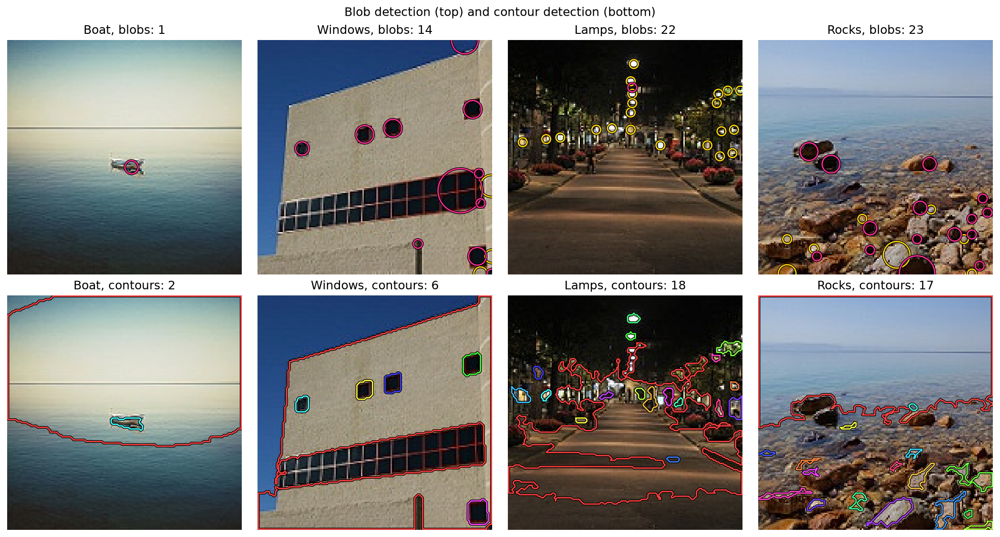

*Figure 10. Boat, windows, lamps and rocks. Top: bright blobs in yellow and dark blobs in pink. Bottom: contours with a unique colour per contour.*

*Table 6. Baseline blob statistics; example centres identify the strongest response in each image.*

| Image | Count (bright/dark) | Radius min/median/max (px) | Example centre (x, y) |
|---|---|---|---|
| Boat | 1 (0/1) | 4.24 / 4.24 / 4.24 | (79, 81) |
| Windows | 14 (3/11) | 2.83 / 4.95 / 14.14 | (137, 44) |
| Lamps | 22 (21/1) | 2.83 / 2.83 / 2.83 | (80, 15) |
| Rocks | 23 (8/15) | 2.83 / 2.83 / 11.31 | (35, 133) |

The boat gives one dark response on its hull. Separate windows are detected, but the long window band produces multiple or oversized responses. Lamps all receive the smallest available radius, so their true sizes are not resolved. Rocks produce responses on shadows, gaps and bright surfaces rather than one detection per stone. Blobs are contrast structures, not semantic objects. Cropped structures and filter border handling can both influence border responses. Our selected images have no annotated blob ground truth, so detection counts alone cannot establish accuracy.

Figure 11 varies threshold, scale range and overlap suppression on the rocks image, keeping the other baseline settings fixed.

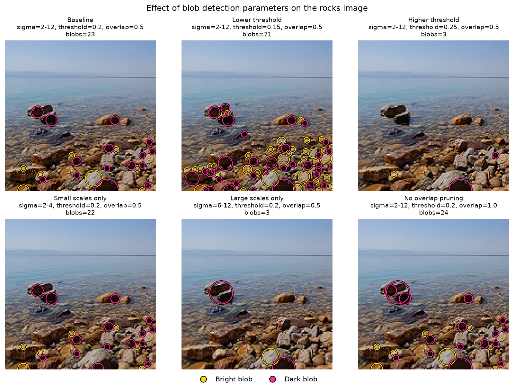

*Figure 11. Effects of threshold, scale range and overlap suppression on rocks.*

Lowering the threshold to 0.15 increases detections from 23 to 71; raising it to 0.25 leaves three. Low thresholds accept weak texture, while high thresholds discard moderate-contrast structures. Restricting σ to 2–4 gives 22 detections; σ = 6–12 gives three broader responses. Disabling overlap pruning gives 24. Threshold and scale matter more than overlap for this example.

## 6. Contour Detection

Contour detection traces boundaries after grayscale threshold or edge processing [1]. We use Otsu thresholding after 5 × 5 Gaussian smoothing on the same four images used for blobs. Pixels above the threshold become white and others black. OpenCV's `findContours` uses `RETR_LIST` and `CHAIN_APPROX_NONE`; contours smaller than 15 pixels² are discarded. `RETR_LIST` returns outer boundaries and holes without hierarchical relationships [6]. Area and perimeter are measured with `contourArea` and `arcLength` [6]. Figure 10 uses a unique visible colour for every contour; Table 7 summarizes measurements. Individual measurements are available in [contours.csv](https://github.com/TrymJohnsen/Image-Processing-Scene-Analysis/blob/main/results/contour/contours.csv).

*Table 7. Baseline contour statistics. Areas are in pixels² and perimeters in pixels.*

| Image | Otsu threshold | Count | Area median/max | Perimeter median/max |
|---|---:|---:|---|---|
| Boat | 129 | 2 | 6724.5 / 13343.5 | 260.4 / 468.3 |
| Windows | 101 | 6 | 124.0 / 14060.0 | 43.7 / 946.5 |
| Lamps | 52 | 18 | 29.8 / 7539.0 | 22.7 / 1293.3 |
| Rocks | 117 | 17 | 40.0 / 10698.0 | 40.1 / 608.6 |

Every image includes a large background-region contour. Contour count is therefore not object count, and holes can add boundaries for one object. For the five separate windows, contours preserve rectangular outlines while blobs describe centres and approximate scales. The window band merges with a larger boundary. Contours follow the boat hull better than a circle, but also outline a broad region caused by uneven brightness.

For lamps, blobs separate many bright spots while thresholded lamps, shop fronts and illuminated ground merge. Neither method isolates individual stones: blobs mark contrast peaks and contours follow bright patches.

Blob detection compares every point with its local surroundings, so gradual brightness changes do not disturb it, bright spots that lie close together stay separate, and several sizes are searched at once. Its limitations are that every blob is a circle, that sizes are restricted to the scales searched, and that it gives no shape information. Contour detection returns the actual outline of a region of any shape, together with its area and perimeter. Its main limitation is the single global threshold: regions that touch in the binary image merge, uneven lighting creates contours that are not objects, and the background itself is returned as a contour.

Figure 12 varies threshold, smoothing and minimum area on the rocks image to inspect changes in the binary-region boundaries.

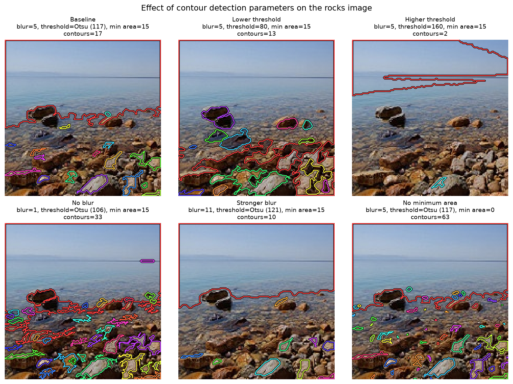

*Figure 12. Effects of threshold, smoothing and minimum area on rocks contours.*

The count changes from 17 at baseline to 13 with threshold 80 and two with 160. Threshold changes can split or merge regions, so counts need not decrease monotonically. Removing blur gives 33 contours; 11 × 11 blur gives ten. Removing the area filter gives 63. Smoothing suppresses small irregularities but can merge structures, while area filtering removes small boundaries. A single global threshold remains sensitive to uneven illumination: background regions can be outlined even when their boundaries have no object meaning.

Blob detection is more suitable for finding or counting small, compact structures, especially under uneven lighting or when they lie close together. The street lamps are an example; stars or cells under a microscope would be similar cases. Contour detection is more suitable when well-separated objects stand out from an even background and their shape or size matters, such as the windows on the wall: a window's area can be measured from its contour, but not from a blob.

## References

[1] K. Sharma, "IT3212: Knowledge Extraction from Data," course lecture slides, Department of Computer and Information Science, Norwegian University of Science and Technology (NTNU), 2026.

[2] NumPy developers. [Discrete Fourier Transform documentation](https://numpy.org/doc/stable/reference/routines.fft.html).

[3] scikit-image developers. [Histogram of Oriented Gradients](https://scikit-image.org/docs/stable/api/skimage.feature.html#skimage.feature.hog).

[4] scikit-image developers. [Example image documentation](https://scikit-image.org/docs/stable/api/skimage.data.html).

[5] T. Ojala, M. Pietikäinen and T. Mäenpää, "Multiresolution gray-scale and rotation invariant texture classification with local binary patterns," *IEEE Transactions on Pattern Analysis and Machine Intelligence*, vol. 24, no. 7, pp. 971–987, July 2002. DOI: [10.1109/TPAMI.2002.1017623](https://doi.org/10.1109/TPAMI.2002.1017623).

[6] OpenCV developers. [Structural Analysis and Shape Descriptors](https://docs.opencv.org/4.x/d3/dc0/group__imgproc__shape.html).

[7] T. Lindeberg, "Feature Detection with Automatic Scale Selection," *International Journal of Computer Vision*, vol. 30, no. 2, pp. 79–116, 1998. DOI: [10.1023/A:1008045108935](https://doi.org/10.1023/A:1008045108935).

## AI declaration

OpenAI ChatGPT and Anthropic Claude were used as helpers for code development, debugging, figure refinement, report review and editing, and discussion. The authors made the methodological choices, carried out the analysis, and developed the final interpretations. 
